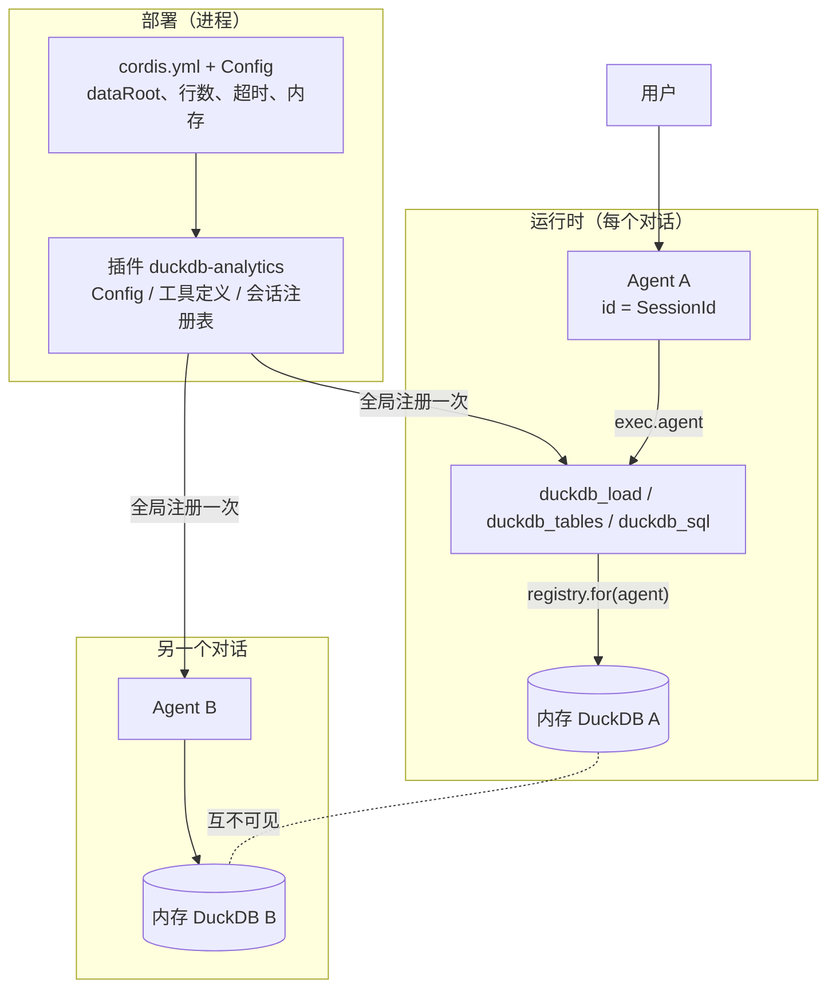

# 02 关系模型：用户、Agent、工具、插件

这一节回答原稿没有正面回答的问题：这四类东西各自拥有什么、谁可以决定什么、状态应该挂在谁身上。MVP 的全部模块划分都是这套关系的直接结果。

## 四个概念

| 概念 | 在本仓库里是什么 | 生命周期 | 数量级 |
| --- | --- | --- | --- |
| **插件** | 一个 Cordis fiber，由 profile 的 `cordis.yml` 加载，导出 `name` / `inject` / `Config` / `apply` | 进程级；配置变更会热替换 | 每个部署 1 个 |
| **Agent** | 会话的运行时拥有者，`Agent.id` 即 `SessionId`，`agent.ctx` 是它的作用域上下文 | 从创建到 `agent/disposed` | 每个对话 1 个（子代理另算） |
| **工具** | 注册进 `ctx.tools` 的模型可见能力，一次调用带 `exec.agent` 与 `exec.signal` | 随注册它的 fiber | 每个插件若干个，全局可见 |
| **用户** | 驱动会话的人；在 Host 里不是一个运行时对象，而是「这个进程背后的操作者」 | 与进程/账号绑定 | 1 个 |

## 关系图

读法：**插件横向铺一次，Agent 纵向各一份，工具是两者之间的连接件，用户只在最上面。**

## 四条硬规则

**R1 插件不持有会话状态。** 插件里可以存在「按 Agent 索引的资源表」，但不能存在「当前会话」「上次查询」这类单值字段。判据：把 `apply` 里的所有闭包变量列出来，任何一个如果只对某一个对话有意义，它就应该挂在 Agent 上而不是插件上。

**R2 工具是能力，不是状态容器。** `defineTool` 的 `execute(args, exec)` 里，归属来自 `exec.agent`，绝不来自参数。模型传的参数只描述「要算什么」，不描述「算谁的」。

**R3 资源按 Agent 归属，随 Agent 释放。** 内存 DuckDB 是该 Agent 的私有资源：`SessionRegistry` 以活的 `Agent` 对象为键（不是 `SessionId` 字符串——字符串可以被模型或客户端伪造，对象不能），`agent/disposed` 时关闭连接与实例，插件卸载时兜底全关。

**R4 用户边界在 UI 与审批层，不在工具里。** 工具不接收 `sessionId`、`userId`、数据目录路径；数据目录由部署配置决定，模型只能给相对路径。权限判断由宿主的审批/权限预设负责，本插件不实现第二套授权。

## 状态归属表

| 状态 | 拥有者 | 存放位置 | 释放时机 |
| --- | --- | --- | --- |
| 已加载的表、DuckDB 实例 | Agent（经插件注册表解析） | 进程内存 | `agent/disposed` / 插件卸载 |
| 表名 → 源文件名的对应 | 同上 | 同上（`SessionDatabase.#sources`） | 同上 |
| 工具定义、参数 schema、输出 schema | 插件 fiber | Cordis 工具注册表 | 插件卸载（注册即 effect） |
| 渲染后的结果文本 | Session 日志 | `tool/result` content | 按仓库的会话保留策略 |
| 数据目录、上限、超时 | 部署配置 | `cordis.yml` → `Config` | 进程重启 / 配置热替换 |
| 用户身份、审批状态 | 宿主 | 用户设置/审批服务 | 与本插件无关 |

注意「已加载的表不在会话日志里」：这是有意选择。日志里只有「模型看到了什么」（渲染文本），表本身是易失的运行时资源。因此刷新页面后图表能重放（文本在日志里），但再问一句 SQL 会得到「表不存在」——MVP 把这条如实告诉模型（`duckdb_tables` 返回空列表），而不是伪造一个缓存。

## 隔离与授权的三层

1. **用户层**：一个进程一个用户；本插件不做用户级隔离，也不应假装做了。
2. **Agent 层**：每个 Agent 一个独立数据库实例，表、连接、内存配额都不共享。这是本项目唯一承诺的隔离，也是唯一需要被测试的隔离。
3. **调用层**：每次工具调用都从 `exec.agent` 重新解析数据库，没有「当前会话」缓存可被污染；模型无法通过参数指定别的会话。

`src/tools.ts` 里每个工具第一句都是 `registry.for(requireAgent(exec.agent))`——这一行就是调用层的全部实现。

## 威胁模型（为什么 MVP 不禁用 DuckDB 的文件访问）

原稿把「SQL 能读文件」当作首要安全风险。放在宿主真实权限里看，这个判断需要修正：

- 同一个 Agent 已经持有 `read`、`glob`、`bash` 等工具，在本机沙箱策略下能读同样的文件。DuckDB 读文件**不扩大** Agent 的既有权限。
- DuckDB 的 `enable_external_access` 只能在**创建实例时**设定（运行时改会报错，见 01 文档 B4）；一旦设为 `false`，`read_csv_auto` 也不可用，导入必须改走「Host 读 → 逐行写入」，而 Node API 没有 `appendRow`，要为每种 DuckDB 类型手写映射。
- `allowed_directories` 在 1.4.x 上**不能**阻止 `read_csv_auto` 读出根目录（已实测）。

所以 MVP 的威胁模型是：

| 必须保证 | 手段 |
| --- | --- |
| 会话之间不串数据 | 每 Agent 独立实例 + 以 Agent 对象为键 |
| 只能读，不能写文件或改库结构 | 语句数由 DuckDB parser 判定为 1；词法层拒绝非 `SELECT`/`WITH` 开头、拒绝表位置的字符串字面量、拒绝读取类函数 |
| 资源有界 | `maxResultRows`、`queryTimeoutMs`（到点 `interrupt()`）、`maxFileBytes`、DuckDB `max_memory` / `threads`，且 `lock_configuration = true` |
| 取消可传导 | `exec.signal` → `connection.interrupt()`，取消原因原样抛出 |

明确**不承诺**：把模型 SQL 关进一个无法触碰文件系统的沙箱。若部署需要这个性质（例如多租户、或 Agent 本身没有文件读取权），按 01 文档 B4 的「甲方案」改建：实例创建即 `enable_external_access: 'false'`，导入改为 Host 中转。触发条件写清楚，比现在假装有更强。

## 明确不做的抽象

「避免过度设计」在这里是可检验的：每条下面都写了**什么条件下才应该引入**。

| 不引入 | 现在的做法 | 什么时候才值得引入 |
| --- | --- | --- |
| `QueryEngine` 服务定义 + Provider | `SessionDatabase` 直接持有 DuckDB 连接 | 出现第二种执行后端（远程 warehouse、DuckDB WASM、另一进程的引擎）时，才拆 Service Definition / Provider / Consumer 三件套 |
| `DataFileLoader` 策略对象 | 扩展名 → reader 函数名，一张三行常量表 | 出现需要 Host 端解析的格式（Excel）时，那一个分支单独成模块，其余仍是常量 |
| 跨端 `shared` 协议包 | 类型定义在 `src/session-database.ts` 内部 | Phase 2 出现浏览器端消费者时，抽出**卡片元数据**（而不是整个查询结果） |
| `presentationMeta` | 不产出 | 有卡片要重建视觉时；没有消费端的元数据是负债 |
| 自研 SQL AST 校验器 | DuckDB parser 判语句数 + 词法层判位置 | 需要「按表/列授权」或多租户隔离时（届时优先找现成 parser，而不是手写） |
| 后台任务 / 流式结果 | 一次调用一次结果 | 单次查询超过工具超时预算，且用户明确要「先返回、后补全」时 |
| 结果缓存、跨会话记忆 | 无 | 出现明确的「同一份数据反复导入」成本证据时 |

## 一句话总结

插件负责**部署**，Agent 负责**归属**，工具负责**能力**，用户负责**授权**。四者不交叉，代码就只需要八个短模块。
