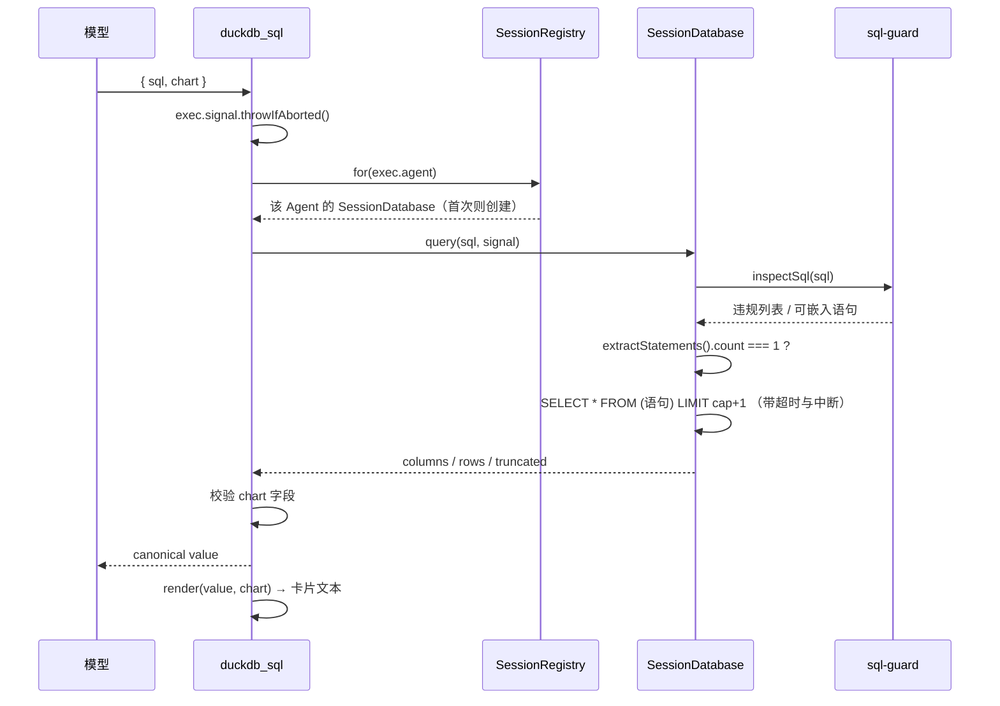

# 03 MVP：设计与实现

第一版目标是**把数据分析闭环做实**：模型能把用户的文件变成可查询的表，能写只读 SQL，结果在对话里读得懂，且会话之间绝不串数据。图表在 [04 文档](04-图表卡片-ECharts.md) 里升级为对话流内的 ECharts 卡片；本文描述 Host 侧闭环与它依赖的文本基线。

## 范围与验收

MVP 做：

- 每个对话一个独立的内存 DuckDB，随 Agent 释放；
- 导入 CSV / Parquet / JSON（DuckDB 原生读取）；
- 单条只读 SQL，带行数上限、超时、可取消；
- 结果文本化：定宽表格 + 可选条形图，直接呈现在工具卡片里；
- 全部上限来自 `cordis.yml` 配置；
- 稳定错误码。

MVP 不做：浏览器端自绘卡片、Excel、图表持久化元数据、后台任务、跨会话缓存、结果导出。

| 编号 | 验收项 | 通过条件 | 状态 |
| --- | --- | --- | --- |
| M1 | CSV 导入 | 表被创建，返回列名/类型/行数/样本 | ✅ `test/tools.test.ts` |
| M2 | Parquet / JSON 导入 | 同上（扩展名白名单） | ✅ `test/data-files.test.ts` |
| M3 | SQL 分析 | 单条 `SELECT`/`WITH` 返回结构化结果 | ✅ `test/session-database.test.ts` |
| M4 | 会话隔离 | 会话 A 看不到会话 B 的表 | ✅ 单元 + 工具两层 |
| M5 | 只读门禁 | DDL/DML/多语句/文件读取函数/表位置字面量被拒 | ✅ 11 组门禁用例 |
| M6 | 结果上限 | 超出上限时 `truncated: true`，只返回上限行 | ✅ |
| M7 | 超时 | 超过预算被 `interrupt()`，错误码 `ANALYTICS_TIMEOUT` | ✅ |
| M8 | 取消 | `exec.signal` 中断在跑的查询，取消原因原样抛出 | ✅ |
| M9 | 路径约束 | 绝对路径、`..` 越界、符号链接越界、超大文件被拒 | ✅（符号链接用例在无权限宿主上跳过） |
| M10 | 图表呈现 | 结果文本含按比例缩放的条形图 | ✅ `test/render.test.ts` |
| M11 | 配置生效 | 七个字段全部来自 Config，缺失 `dataRoot` 加载即失败 | ✅ 代码 + 手工 |
| M12 | 释放 | Agent 释放 / 插件卸载后连接与实例关闭 | ✅ |

Phase 2 才验收的项（原稿把它和 MVP 混在一张表里，导致无法判定）：Excel 导入。图表卡片与 `presentationMeta` 已在 [04 文档](04-图表卡片-ECharts.md) 交付。

## 模块与职责

| 文件 | 职责 | 依赖 |
| --- | --- | --- |
| `src/index.ts` | 插件入口：`Config`、`apply`，注册工具、挂生命周期 | Cordis、Schemastery |
| `src/tools.ts` | 三个工具的定义：参数/输出 schema、execute、渲染接线 | `dsh-tools` |
| `src/session-registry.ts` | 按 Agent 归属的数据库表：`for` / `release` / `releaseAll` | — |
| `src/session-database.ts` | 一个 DuckDB 实例：导入、查询、串行化、超时、关闭 | `@duckdb/node-api` |
| `src/sql-guard.ts` | 纯函数：SQL 词法检查 + 可嵌入语句文本 | — |
| `src/data-files.ts` | 路径约束、格式白名单、表名派生 | `node:fs/promises` |
| `src/render.ts` | 纯函数：表格、条形图、各类结果文本 | — |
| `src/errors.ts` | `AnalyticsError` + 三个稳定 code | `dsh-llm` |

依赖方向是单向的：`index → tools → {registry, database, data-files, render, errors}`，`sql-guard` 与 `render` 是叶子。没有循环，没有服务注册。

## 工具契约

三个工具全部全局注册一次（`apply` 中），每次调用用 `exec.agent` 解析数据库。

### `duckdb_load`

| 参数 | 类型 | 必填 | 说明 |
| --- | --- | --- | --- |
| `filePath` | string | 是 | 相对数据目录的路径 |

输出：`{ table, source, rows, columns: [{name,type}], sample: Row[] }`（`sample` 最多 5 行）。

渲染：`Loaded sales.csv as table "sales" (5 rows).` + 列定义 + 样本表格。

表名由 Host 派生（`data-files.ts#tableNameFor`）：文件名主干小写、非字母数字折成 `_`、首字符非字母则加 `t_` 前缀、库内冲突加 `_2`。模型拿到的就是这个表名，下一句 SQL 直接用，不需要搬运不透明 id。

### `duckdb_tables`

无参数。输出 `{ tables: [{ table, rows, source }] }`。渲染为列表或 `No tables are loaded in this conversation yet.`。

存在意义：对话变长后模型会忘记加载过什么，猜表名比多调一次工具更贵。

### `duckdb_sql`

| 参数 | 类型 | 必填 | 说明 |
| --- | --- | --- | --- |
| `sql` | string | 是 | 单条 `SELECT` 或 `WITH … SELECT` |
| `chart` | object | 否 | `{ type: 'bar', x, y, title? }` |

输出：`{ sql, columns, rows, rowCount, truncated }`。

渲染：`N row(s).`（超上限时加 `(truncated by the result cap)`）+ 可选条形图 + 定宽表格。

图表参数在 `execute` 里就校验：`x`/`y` 必须是结果列，`y` 至少要有一个数值（BIGINT 列经 JSON 转换后是字符串，`renderBarChart` 会接受数值字符串）。非法时抛 `ANALYTICS_REQUEST_REJECTED`，而不是静默不画——静默失败会让模型以为图画出来了。

### 错误码

| code | 含义 | 例子 |
| --- | --- | --- |
| `ANALYTICS_REQUEST_REJECTED` | 引擎接受之前的拒绝：路径、格式、语句、图表字段、解析/绑定失败 | `chart.y "profit" is not a result column` |
| `ANALYTICS_TIMEOUT` | 超过 `queryTimeoutMs` 并被中断 | 全表笛卡尔积 |
| `ANALYTICS_ENGINE` | 会话已关闭、插件已卸载、配置的 DuckDB 参数被拒 | 释放后再查 |

取消不包装：`exec.signal` 触发时抛 `signal.reason`，让执行器按 `ABORTED` 处理。

## 一次调用的数据流



`LIMIT cap + 1` 是刻意多取一行：用于判定 `truncated`，同时不改写原语句的语义（包一层子查询，`ORDER BY`/`GROUP BY` 都保持原有作用域）。

## 安全实现

两层，各管一件事，互不依赖：

1. **语句数**：`connection.extractStatements(sql).count === 1`。DuckDB 自己的 parser 认定，`SELECT 1; DROP TABLE sales` 判 2 条（同时词法层也会因内部的 `;` 拒绝，双保险）。
2. **语义位置**：`inspectSql` 先分词（正确跳过 `'…'`、`"…"`、`--`、`/* */`、`$tag$`），再判定：
   - 首个 token 必须是 `SELECT` 或 `WITH`（挡掉所有 DDL/DML/`COPY`/`ATTACH`/`SET`/`PRAGMA`）；
   - 表位置（`FROM` / `JOIN` / 表列表逗号之后）不得是字符串字面量（挡掉 `FROM 'sales.csv'`）；
   - 调用位置不得是读取类函数（`read_*`、`*_scan`、`scan_*`、`glob`、`sniff_*`、`st_read`、`parquet_metadata` 等）。

已知的过度严格：`json_each('[1,2]')` 这类在 `FROM` 里带字符串参数的函数会被拒；`SELECT 1 ; ;` 会被判多条。两者都在测试里固化为期望行为，若真实使用中造成阻塞，再按需放宽（并补用例）。

资源上限：`maxResultRows`、`queryTimeoutMs`、`maxFileBytes`、`maxMemory`、`threads` 全部来自配置；实例创建后设置 `max_memory` / `threads`，随后 `SET lock_configuration = true`，使任何语句都无法在运行期改这些值。

## 生命周期与并发

- **创建**：首次工具调用时 `registry.for(agent)` 懒创建。不监听 `agent/created`，因此 `resume` / `clear` / `compact` 不需要分支。
- **串行**：一个 DuckDB 连接不是可重入的，`SessionDatabase` 内部用一条 promise 链串起所有操作（`#enqueue`），关闭也走这条链，保证「先结算在跑的语句，再关」。
- **超时**：`setTimeout` 到点调 `connection.interrupt()`；连接在中断后可继续使用（已测）。
- **取消**：监听 `exec.signal`，同样通过 `interrupt()`；随后把 `signal.reason` 原样抛出，不包装成 `AnalyticsError`。
- **释放**：`agent/disposed` → `registry.release(agent)`；插件卸载 → `ctx.effect` 的清理函数 `releaseAll()`。释放后再调用会拿到一个全新的空库（可观测行为，测试已固化）。
- **热替换**：`cordis.yml` 改配置会卸载旧实例再加载新实例；旧实例的 effect 清理会关闭所有数据库。

## 渲染与卡片现状

内置 Web 客户端**不消费** `presentCall` / `presentResult`；通用工具行渲染的是模型可见的结果文本。所以 MVP 的「卡片」就是 `output.render` 产出的文本（下面是 `data/sales.csv` 的真实输出，`maxResultRows` 设为 3）：

```
3 row(s) (truncated by the result cap).

sales by month
2025-09  ██████████████████████░░  184000
2025-09  ██████████████████░░░░░░  152000
2025-10  ████████████████████████  201500

month    sales
───────  ──────
2025-09  184000
2025-09  152000
2025-10  201500
```

渲染约束：单元格最多 40 字符、表格最多 20 行、条形图最多 15 根、CJK 按双宽计算以保持对齐。`BIGINT` 经 `getRowObjectsJson()` 输出为字符串（JSON 无法无损表示 64 位整数），这一点在渲染和图表取值处都做了处理。

## 测试

```sh
cd dsh-duck-analytics && npm test        # 单进程跑完全部测试文件
cd dsh-duck-analytics && npm run typecheck
```

77 个用例：`sql-guard` 12、`render` 12、`data-files` 14、`session-database` 13、`chart-meta`（合并于 client-bundle 与 tools）、`client-bundle` 10、`client-row` 1、`tools` 16。真实 DuckDB，不用 mock；临时目录建在 `test/.tmp-*` 并在 `after` 里清理。

两个环境事实决定了测试入口的形状：

- DSH 文件沙箱不允许起子进程，`node --test` 每个文件一个子进程会 `spawn EPERM`，所以用 `test/all.mjs` 单进程顺序导入。
- 插件的运行时依赖（`dsh-tools` / `dsh-llm` / `schemastery`）在仓库构建产物里，不在 scratch 目录的 `node_modules`；生产时由 tsx 按仓库 tsconfig `paths` 解析，测试进程用 `test/hooks.mjs` 的解析钩子指向同一批产物。

## 运行

```sh
# 仓库根目录
pnpm dsh web --patch ./dsh-duck-analytics/cordis.yml
```

`cordis.yml` 里 `dataRoot` 是绝对路径，指向 `dsh-duck-analytics/data`；换目录只改这一行。`data/sales.csv` 是可直接用的示例数据。

对话示例：

> 加载 sales.csv，按月汇总销售额并画条形图，指出增长最快的区域。

## 已知限制

- 表是易失的：进程重启、Agent 释放、插件重载后需要重新导入。这是有意的（不把完整数据集写进会话日志）。
- 单表导入不设行数上限，靠 `maxFileBytes` + DuckDB `max_memory` 兜底；超大 CSV 会以内存错误失败，而不是被优雅截断。
- 不支持 Excel（Phase 2）。
- SQL 门禁是词法级而非 AST 级，残余风险与升级条件见 `02-关系模型.md`。

图表在对话流内的渲染见 [04 文档](04-图表卡片-ECharts.md)：ECharts 卡片由同一 Loader 条目的浏览器半提供，元数据走 `presentationMeta`，文本渲染保留为模型可读内容与降级路径。

## Phase 3：更强的隔离（触发条件与代价）

当部署要求「模型 SQL 完全无法触碰文件系统」时（多租户、或 Agent 本身没有文件读取权）：

- 实例创建即 `enable_external_access: 'false'`（实测有效）；
- 导入改为：Host 用临时 loader 实例读文件 → 取 schema 与行 → 在受限实例建表并写入；
- 代价：Node API 没有 `appendRow`，需按列类型调用 `appendX` 系列，或退回逐值绑定；内存翻倍、导入变慢，且 `BIGINT`/`DATE` 等类型要显式转换。

在这条需求出现之前，不为它写抽象。
